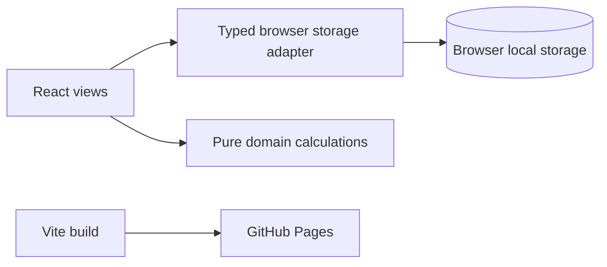

# Training Planner Developer Guide

## Runtime Architecture

Training Planner v2 is a local-first static React web application. Vite bundles the frontend and GitHub Pages serves the generated `dist/` files. There is no Electron process, server-side API, or runtime Node.js dependency.



`src/main.tsx` creates a `PlannerRepository` and supplies it through `RepositoryProvider`. Components obtain it with `useRepository()` and do not access browser storage or `window` directly. Entity IDs are UUID strings generated with `crypto.randomUUID()`.

## Source Layout

| Path | Responsibility |
| --- | --- |
| `src/App.tsx` | Application shell, navigation, initial state load, and theme application. |
| `src/views.tsx` | Dashboard, Planner, run logging, goals, and settings views. |
| `src/session-builder.tsx` | Reusable structured-session editor and Planner session panel. |
| `src/data/repository.ts` | `PlannerRepository` interface: every persistence command, each resolving to the full next `PlannerState`. |
| `src/data/repository-context.tsx` | React context; views call `useRepository()` and never touch storage or `window` directly. |
| `src/data/local-repository.ts` | Temporary `localStorage` implementation (key `training-planner-local-v3`). Removed in Phase 2 when the Supabase repository replaces it. |
| `e2e/` | Playwright smoke tests (`*.e2e.ts`), run against a production build. |
| `src/domain.ts` | Pure calculations, formatting, and date utilities. |
| `src/types.ts` | Shared persisted entities and typed command payloads. |
| `src/styles.css` | Shared responsive visual system. |
| `src/domain.test.ts` | Domain calculation tests. |
| `.github/workflows/deploy-pages.yml` | Static GitHub Pages deployment workflow. |

## Persistence Contract

The local repository stores a versioned state envelope under `training-planner-local-v3`. It does **not** read the earlier `training-planner-state-v2` or preview keys, because v3 starts fresh (see [V3_PLAN.md](V3_PLAN.md) section 5); old data is left untouched in the browser. Each command reads state, validates its input, produces a complete next snapshot, and writes that snapshot in one `localStorage` operation.

Browser storage is tied to the browser profile and deployed site origin. Clearing site data, using a different browser, or using another GitHub Pages origin starts a separate local data set. The v1 Electron SQLite database cannot be imported automatically by a static browser application; a separate desktop export/import tool is required for that migration.

## Development

Requirements: Node.js 22 or later.

```powershell
npm.cmd install
npm.cmd run dev
npm.cmd run typecheck
npm.cmd run lint
npm.cmd test
npm.cmd run test:e2e
npm.cmd run build
```

`npm run test:e2e` builds the site, serves it on port 4173 and runs Playwright in Chromium. Install the browser once with `npx playwright install chromium`.

`npm run dev` starts the Vite web server. `npm run build` creates the static production artifact in `dist/`. `npm run lint` runs Oxlint (`typescript-eslint` does not yet support TypeScript 7). `npm run format` runs Prettier; the existing code has not been bulk-formatted, so format only files you are changing.

The CI workflow ([ci.yml](../.github/workflows/ci.yml)) runs typecheck, lint, tests, `npm audit --audit-level=high` and a production build on every pull request and on pushes to non-`main` branches.

## GitHub Pages Deployment

Enable **GitHub Actions** as the repository's Pages source. On a push to `main`, the deployment workflow installs locked dependencies, builds with `VITE_BASE_PATH` set to `/<repository-name>/`, uploads `dist/`, and deploys it.

For a custom domain or a non-Pages host, build with the appropriate base path:

```powershell
$env:VITE_BASE_PATH = "/"
npm.cmd run build
```

## Change Guidelines

1. Add the command to `PlannerRepository` in `src/data/repository.ts` (and its input type in `src/types.ts`).
2. Implement validation and the atomic state update in `src/data/local-repository.ts`, with tests in `local-repository.test.ts`.
3. Keep shared calculations in `src/domain.ts` and add focused Vitest coverage.
4. Update React views to call the command through `useRepository()`.
5. Run typecheck, tests, and a Vite production build before deployment.
