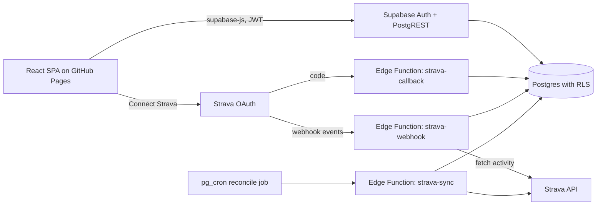

# Training Planner v3 Plan

Status: **Decisions recorded, ready to start Phase 0** · Updated: 2026-11-12 · Baseline: v2.0.0 (local-first static site)

Decisions so far (full table in [section 11](#11-decision-log-and-open-questions)): personal, non-commercial use shared privately with a few people; Supabase; email magic-link login; online only; no v2 data migration; Strava `activity:read`; Strava runs read-only; import Run and TrailRun only; Strava optional but available to every user; imported runs kept on disconnect; no route maps; stay on `github.io`; repo stays public.

v3 goals:

1. **Accounts and cloud persistence**: replace browser `localStorage` with a hosted database behind a login.
2. **Strava sync**: pull the athlete's runs from Strava automatically and reconcile them with the training plan.

Questions for you are marked **Q#** and collected in [section 11](#11-decision-log-and-open-questions). Each has a recommended default so work can proceed if you agree.

---

## 1. Review of v2: what exists

### 1.1 Implemented

| Area | Summary |
| --- | --- |
| Goals and plans | Create, edit and cancel one active goal (name, race date, plan start, preset or custom distance, target time). |
| Planner | Week and month calendar bounded by plan dates, drag-and-drop and date-based rescheduling, skip, status styling. |
| Sessions | Run types, target distance/duration/pace range, notes, reusable structured templates (warm-up, repeat with children, rest, cool-down). |
| Run logging | Planned and unplanned runs; hh:mm:ss durations; edit and delete; session reopens if its only run is deleted. |
| Dashboard | Goal countdown, this-week planned vs completed, Plan Status bar, longest run and highest week, plan-distance chart, next session, recent activity. |
| Platform | Light/dark/system theme, versioned `localStorage` envelope, legacy-key migration, GitHub Pages workflow, Vitest domain tests. |

### 1.2 Not implemented or partial (against [REQUIREMENTS.md](REQUIREMENTS.md))

The requirements file is slightly stale: M-19 (edit/delete runs) and the week/month toggle were delivered after it was last updated (see [Bugs.md](Bugs.md)).

| ID | Gap | v3 relevance |
| --- | --- | --- |
| M-20 | Per-interval actual results | Strava laps can populate this. Natural v3 fit. |
| M-26 | Elevation-over-time chart | Strava supplies elevation reliably. |
| M-28 | PRs for fastest 5K/10K/HM/marathon | Strava provides `best_efforts`; also computable from runs. |
| M-29 | Unplanned runs counted in adherence and explained | Matters more once Strava auto-imports many unplanned runs. **Must fix before sync.** |
| M-04 | Archive rather than delete on cancel | Required before cloud: users expect history to survive. |
| S-01, S-04 | Duplicate session; chart time windows | Optional. |
| C-01, C-02 | JSON export/import | Not needed for migration (no v2 data carried over). Account data export is in Phase 3. |
| UX-39, UX-43 | Unsaved-form warning; full keyboard operation | Quality backlog. |

### 1.3 Code issues found during review

These affect v3 design and should be fixed early (Phase 0).

1. **`createGoal` wipes sessions.** `sessions: []` in [local-repository.ts](../src/data/local-repository.ts) (previously `browser-api.ts`) deletes all prior sessions when a new goal is created, so "archived plans" keep only a goal row. Runs also have no `goal_id`, so history cannot be attributed to a plan.
2. **`nextSession` is unordered.** [domain.ts](../src/domain.ts) takes the first scheduled session in array order, not the earliest upcoming date, and does not exclude past dates.
3. **Current-week lookup is fragile.** The dashboard finds the current week by comparing formatted date labels instead of date keys.
4. **Adherence ignores unplanned runs.** `planStatus` counts only session status, contradicting the M-24/M-29 policy.
5. **Numeric auto-increment IDs** (`max + 1`) are not safe for a multi-device database. v3 needs UUIDs.
6. **Whole-state snapshot API.** Every command returns the entire `PlannerState`. Fine locally; wasteful over a network. It is also a convenient migration seam (see 3.2).
7. **Limited test coverage.** Only `domain.test.ts`. There was no coverage of repository validation or the UI. Phase 1 added both (see below).
8. **Doc drift.** Some Bugs.md entries still record "not checked manually in a browser".

---

## 2. Scope of v3

### 2.1 In scope

- **Invite-only** accounts (public sign-up disabled), login, logout and session persistence.
- Server-side database of all planner data, isolated per user (each person has their own private plan).
- Connect and disconnect a Strava account. Strava is **optional per user**: the planner and manual logging work fully without it, and every user can connect their own Strava account if they wish.
- A fresh start: v2 browser data is **not** migrated and `localStorage` persistence is removed.
- Backfill historic Strava runs, then keep in sync through webhooks.
- Match imported activities to planned sessions (suggest and confirm).
- Dashboard features that Strava data enables: elevation chart, fastest-distance PRs, lap/interval results.
- Account deletion and data export (privacy).

### 2.2 Out of scope for v3 (proposed)

- Garmin or other providers (design a provider-neutral `source` field but build only Strava).
- Viewing another person's plan or data (coach/athlete sharing). Each invited user only sees their own data; Strava terms also restrict showing an athlete's data to others.
- Offline use or a guest/local mode.
- Commercial use, billing, or public self-service sign-up.
- Pushing planned workouts to Strava or watches.
- Automated plan generation.
- Native mobile app (a responsive PWA is acceptable).

### 2.3 Requirements that v3 supersedes

| Requirement | Change |
| --- | --- |
| W-01, W-02 | Strava and accounts/cloud sync move **into** scope. |
| N-03 Privacy | Data is now transmitted to and stored on a hosted service. Add a privacy notice. |
| T-02, T-03, T-04 | Persistence becomes a remote repository. The "no backend" constraint is lifted. |
| M-32/M-33 | Core workflows now need a network and an account. Decided: online only (**Q4**). |

---

## 3. Recommended architecture

### 3.1 Why a backend is unavoidable

Strava OAuth requires a **client secret** to exchange and refresh tokens, and webhooks need a public HTTPS endpoint that replies within about 2 seconds. A pure GitHub Pages site can do neither safely. Refresh tokens must also be kept off the browser. So v3 needs a small server-side component, plus a database and auth.

### 3.2 Recommendation: keep the React static site, add Supabase



| Option | Pros | Cons |
| --- | --- | --- |
| **Supabase (recommended)** | Postgres, built-in Auth (email magic link, password, Google), row-level security, Edge Functions for the secret-holding Strava code, cron, generous free tier, SQL migrations in git. The frontend can stay on GitHub Pages. | Free projects pause after about a week of inactivity. Deno-based functions. Vendor coupling (mitigated by standard Postgres). |
| Firebase | Easy auth, Firestore, Cloud Functions. | NoSQL model suits relational plan/session/run data poorly. Functions need a paid plan. |
| Cloudflare Workers + D1 | Cheap, fast, no pausing. | Auth must be built or bolted on. Less mature tooling for this stack. |
| Own Node API + Postgres (Fly/Railway/Render) | Full control. | You own auth, security patching, hosting and ops. Most work. |

Decided (**Q1**): Supabase. You do not need prior experience. The free tier and local CLI are enough to learn it, and the plan below includes the steps.

### 3.3 Frontend seam

Phase 1 turned the old `window.trainingPlanner` global into the `PlannerRepository` interface in [repository.ts](../src/data/repository.ts), injected via `useRepository()`. Phase 2 adds a second implementation; the views do not change.

```
src/
  data/
    repository.ts        # PlannerRepository interface
    local-repository.ts  # current localStorage code; temporary fake for dev/tests, deleted after Phase 2
    supabase-repository.ts
  auth/                  # AuthProvider, LoginView, session hooks
  integrations/strava/   # connect button, status, sync UI (no secrets)
supabase/
  migrations/            # SQL schema + RLS, versioned
  functions/
    strava-callback/
    strava-webhook/
    strava-sync/
```

Pragmatic first step: after each mutation the remote repository re-fetches full state. That is fine for one runner (hundreds of rows). Move to granular queries with TanStack Query only if it becomes slow.

### 3.4 Data model (Postgres)

Every row carries `user_id` and has row-level security so users can only read and write their own rows.

| Table | Key columns |
| --- | --- |
| `profiles` | `user_id` (pk, FK to auth.users), `theme`, `calendar_format`, `created_at` |
| `goals` | `id uuid`, `user_id`, `name`, `race_date`, `plan_start_date`, `distance_km`, `target_time`, `status` (`active` or `archived`), `archived_at` |
| `session_templates` | `id`, `user_id`, `name`, `notes`, `segments jsonb` (keep the existing nested shape) |
| `sessions` | `id`, `user_id`, `goal_id`, `scheduled_date`, `run_type`, `target_distance_km`, `target_duration_seconds`, `pace_low`, `pace_high`, `notes`, `status`, `original_date`, `template_id` |
| `runs` | `id`, `user_id`, `goal_id` (nullable), `session_id` (nullable), `completed_date`, `distance_km`, `duration_seconds`, `elapsed_seconds`, `rpe`, `avg_heart_rate`, `max_heart_rate`, `elevation_m`, `notes`, `is_unplanned`, **`source`** (`manual` or `strava`), **`external_id`** (Strava activity id), `external_name`, `external_updated_at`; unique `(user_id, source, external_id)` |
| `run_laps` | `id`, `run_id`, `lap_index`, `distance_km`, `duration_seconds`, `avg_heart_rate` (satisfies M-20) |
| `strava_connections` | `user_id` (pk), `athlete_id`, `scope`, `access_token`, `refresh_token`, `expires_at`, `connected_at`, `last_sync_at`, `backfill_cursor`. **No client-side RLS policy**, service role only. |
| `strava_webhook_events` | `id`, `object_id`, `owner_id`, `aspect_type`, `received_at`, `processed_at`, `error` (idempotency and debugging) |

Notes:

- Store distance in km and time in seconds as today. Convert Strava metres to km at import.
- Use `moving_time` as `duration_seconds` (matches how runners think of pace) and keep `elapsed_seconds` too.
- Add `goal_id` to runs so plan history is attributable. For legacy runs, infer it from the linked session.
- Archiving a goal sets `status = 'archived'` and keeps sessions and runs (fixes M-04 and review issue 1).
- Enforce "one active goal per user" with a partial unique index: `unique (user_id) where status = 'active'`.

### 3.5 Authentication

A login is required, as you assumed. Recommended:

- **Supabase Auth with email magic link only** (decided: easiest). No passwords to store or reset, and no Google Cloud setup. Revisit Google later if wanted.
- **Invite-only**: turn off "Allow new users to sign up" in Supabase, and invite each person by email from the dashboard. This keeps a private app private and stays well inside Strava's small-user limits.
- **Strava is a linked data source, not the identity.** "Sign in with Strava" is not an identity provider Supabase supports out of the box, and it ties account recovery to Strava. Users log in with email or Google, then press **Connect Strava**.
- Session in the browser is a short-lived JWT with refresh, handled by `supabase-js`.
- Add Row Level Security policies in the first migration and **test them** (a user cannot read another user's rows).

Magic-link emails use Supabase's built-in sender, which is rate-limited (a few per hour) and can land in spam. That is fine for a handful of users; configure a custom SMTP provider if it becomes annoying.

---

## 4. Strava integration design

### 4.1 Setup (manual, one time)

1. Create an API application at the Strava developer settings page. Record the Client ID and Client Secret.
2. Set the **Authorization Callback Domain** to the Supabase functions domain, for example `<project-ref>.supabase.co`. This makes the callback land on an Edge Function, which then redirects to the site. This avoids the GitHub Pages sub-path problem (`/RunPlanner/`).
3. Store `STRAVA_CLIENT_ID`, `STRAVA_CLIENT_SECRET` and `STRAVA_WEBHOOK_VERIFY_TOKEN` as Supabase function secrets. **Never** in the Vite bundle or the repo.
4. Verify current API terms, limits and brand rules at the Strava developer docs before building (see 4.6).

### 4.2 Connect flow

1. UI calls an Edge Function (or builds the URL) that creates a random `state` value tied to the signed-in user.
2. Redirect to `https://www.strava.com/oauth/authorize` with `scope=read,activity:read` and `approval_prompt=auto`.
3. Strava redirects to `strava-callback?code=...&state=...&scope=...`.
4. The function validates `state` (CSRF protection), checks the **granted scope** (users can untick `activity:read_all`), exchanges the code at `https://www.strava.com/oauth/token`, and saves tokens in `strava_connections`.
5. Redirect back to the app Settings page; the UI shows "Connected as <athlete>" and starts the backfill.

Decided: `activity:read` (least privilege). It returns activities visible to Everyone or Followers, and excludes "Only me" activities and privacy-zone data. Runs set to "Only me" on Strava will therefore never appear in the app; tell users this in the connect UI. The scope can be widened later by re-authorizing.

### 4.3 Token handling

- Access tokens expire after about 6 hours. Before each API call, refresh if `expires_at` is near. **Persist the new refresh token every time**, because Strava may rotate it.
- Tokens live only in `strava_connections`, reachable only by the service role. Consider Supabase Vault or column encryption.
- Disconnect = call Strava deauthorize and delete the connection row (tokens). Imported runs are **kept** (**Q14**, decided) and stay read-only with their Strava badge; a separate "Delete imported Strava runs" action is offered. Account deletion removes everything.
- Because Strava is per user, every `strava_*` query and function is keyed by `user_id`; the webhook maps `owner_id` (Strava athlete id) back to the right user.

### 4.4 Sync strategy

| Mode | Trigger | Behaviour |
| --- | --- | --- |
| Backfill | After connect, or manual "Sync now" | Page `GET /athlete/activities` (`per_page=200`, `after=cursor`) in chunks that respect rate limits. Resume from `backfill_cursor`. Keep only `Run` and `TrailRun` types (**Q7**, decided). Filter on `sport_type`, not the older `type`. |
| Live | Strava webhook | `create`: fetch `GET /activities/{id}`, upsert. `update`: re-fetch and upsert (title, type or privacy changes). `delete`: remove the imported run. `athlete` event with `authorized: false`: delete tokens. |
| Reconcile | Nightly cron | Fetch last 7-14 days and upsert to repair missed webhooks. |

Webhook specifics:

- One subscription per Strava app. Create it once with `POST /push_subscriptions`.
- Validation `GET` must echo `hub.challenge` as JSON `{ "hub.challenge": ... }`.
- The `POST` handler must return 200 **quickly** (about 2 seconds). Insert the event into `strava_webhook_events`, return, and process asynchronously.
- Be idempotent: upserting on `(user_id, source, external_id)` makes retries safe.

Rate limits are low by default (roughly 100 read requests per 15 minutes and 1,000 per day; verify). Backfilling a long history needs paging across multiple invocations. Do not fetch laps for every activity during backfill; fetch laps lazily or only for matched or recent runs.

### 4.5 Reconciling activities with the plan

Imported activities are `is_unplanned = true` until matched.

1. **Auto-suggest**: same local date as a `scheduled` or `rescheduled` session whose distance is within a tolerance (for example 25%), preferring the closest distance. Same date and a single candidate session gives a high-confidence match.
2. **Confirm in the UI**: a "Needs review" list on the Run log and dashboard. One click confirms, changes the session, or marks the run as unplanned.
3. On match: set `session_id`, mark the session `completed`, and copy nothing back to the plan (targets stay as planned, giving planned vs actual).
4. **Manual edits to Strava runs** (**Q8**, decided): Strava-sourced numeric fields (distance, time, elevation, heart rate) are read-only, while notes, RPE and the session link stay editable. The sync upsert must never overwrite those editable fields.
5. **Duplicates**: a user might also log a run by hand that Strava later imports. Offer "merge with manual run" when date and distance are within a small tolerance.

Local date matters: use Strava's `start_date_local` for `completed_date`, not the UTC `start_date`.

### 4.6 Strava terms and brand (verify before building)

Check these against the current Strava API Agreement and brand guidelines. They have changed in the past.

- Show the "Connect with Strava" button using Strava's official assets, and "Powered by Strava" / "View on Strava" links where Strava data is shown.
- Strava data may only be displayed to the athlete it belongs to. This is fine for a personal app, but rules out any sharing feature in v3.
- Strava data must not be used to train AI/ML models.
- On deauthorization, delete the athlete's Strava data from your systems.
- New API apps are typically limited to a single connected athlete (the app owner) until Strava approves a higher limit, and approval is judged on the app's purpose. Because every user must be able to connect (**Q13**, decided), request an athlete-limit increase **now**: approval is judged on the app's purpose and is **not guaranteed**, so check the current rules first. Until approved, only you can connect Strava; the Connect button for other users should show a clear "Strava sync is not yet available for your account" state, and they use manual logging. Nothing else in the app may depend on Strava being connected.

---

## 5. Migration from v2 local data

**Not required** (decided, **Q10**). v3 starts empty and `localStorage` persistence is removed once the Supabase repository works. This removes the v2.1 export/import release, the legacy-state migration code and the import wizard from scope.

If you want to keep any v2 plan, re-enter it by hand, or take a copy of the `training-planner-state-v2` value from the browser dev tools (Application, Local Storage) before Phase 2 as a reference.

---

## 6. Security and privacy checklist

- [ ] RLS enabled on **every** table; policies tested for cross-user denial.
- [ ] Service-role key used only inside Edge Functions. The anon key is the only key in the frontend (it is public by design).
- [ ] Strava secret, tokens and webhook verify token are never in the browser, repo or logs.
- [ ] OAuth `state` parameter validated and single use.
- [ ] Webhook endpoint checks the `subscription_id` and only acts on known `owner_id` values.
- [ ] Input validation moved server-side (database constraints and checks), not just the client-side repository.
- [ ] CORS and redirect URLs restricted to the production origin and localhost.
- [ ] Content Security Policy appropriate for GitHub Pages (meta tag) with Supabase and Strava domains allow-listed.
- [ ] Privacy notice: what is stored, that Strava data is stored, how to export or delete.
- [ ] **Account deletion** that removes all rows and revokes Strava.
- [ ] Logs exclude run notes, tokens and GPS data. Do not store GPS polylines unless you decide you want maps (**Q9**).
- [ ] Dependency audit (`npm audit`) in CI.

---

## 7. Phased delivery plan

Each phase ends in a working, deployable state. Check each box before moving on.

### Phase 0: Close out v2 and fix foundations

Goal: stable baseline and a safety net before touching persistence.

- [x] Update [REQUIREMENTS.md](REQUIREMENTS.md) statuses (M-19, M-09, M-06, M-29, S-02, S-05, C-04 now done).
- [ ] Commit Phase 0 and tag the repo `v2.0.0` (left for you to do).
- [x] Fix the `domain.ts` issues that survive into v3 (section 1.3, items 2 to 4): next-session ordering and past dates, current-week lookup by date key, unplanned runs in adherence (M-29) with an explanation in the UI. Unit tests added (16 passing).
- [ ] Issue 1 (archiving) and the run `goal_id` are fixed in the new Supabase schema and repository, not in `local-repository.ts`, which is being retired. Do not invest in the local store.
- [x] Add a linter, Prettier, a `lint` script and a CI workflow running typecheck, lint, tests, audit and build on pull requests. Oxlint was used instead of ESLint because `typescript-eslint` does not support TypeScript 7. `npm audit fix` cleared 5 dev-dependency advisories.
- [ ] Manually verify items in Bugs.md flagged "not checked manually" (needs you in a browser).

**Done when:** CI is green on PRs and the adherence policy is visible on the dashboard.

### Phase 1: Repository abstraction and IDs

- [x] Extract `PlannerRepository` (`src/data/repository.ts`); local code moved to `src/data/local-repository.ts` as a temporary implementation; injected through React context (`useRepository()`) instead of `window`.
- [x] Entity IDs are string UUIDs. The local store uses a new key (`training-planner-local-v3`) and ignores v2 data. `SessionTemplateSegment.id` and `RepeatSubSegment.id` stay numeric: they are positions inside a template, not database entities.
- [x] Loading state and a "Try again" error screen on startup (UX-41/42). Per-command errors still use the existing banner.
- [x] Playwright smoke tests (`e2e/`) for: empty dashboard, create goal / add session / log run / reload, unplanned run counted and deleted, template reuse, theme persistence, storage-failure retry. Run in CI.
- [x] Repository unit tests (`src/data/local-repository.test.ts`, 19 tests) cover validation, ID uniqueness, reschedule/skip/reopen, plan edit and cancel cascades, and read/write failures.

**Done when:** the app behaves identically, all tests pass, and no component references `window.trainingPlanner` or `localStorage`. (Only `src/data/local-repository.ts` touches `localStorage`.)

**Notes for Phase 2:**

- The `PlannerRepository` contract returns the whole `PlannerState` from every command. `supabase-repository.ts` can implement each command as a write followed by a re-fetch.
- `Goal.active` and `Run.is_unplanned` are still numbers (0/1) in the app types; map them from the database's `status` and `source` columns inside the Supabase repository.
- The local repository is intentionally kept until Supabase works; delete it and its tests then.

### Phase 2: Supabase, schema and auth

- [ ] Create **two** Supabase projects (dev and prod). Install the Supabase CLI and `supabase init`; keep `supabase/` in git.
- [ ] Write migrations for the tables in 3.4, including constraints, indexes, the one-active-goal index and RLS policies. Archiving a goal keeps its sessions and runs (fixes M-04).
- [ ] Disable public sign-ups in Supabase Auth settings.
- [ ] Write RLS tests (SQL or pgTAP) proving cross-user isolation.
- [ ] Add `@supabase/supabase-js`, `AuthProvider`, a login screen (magic link), logout in Settings, and a signed-out guard.
- [ ] Implement `supabase-repository.ts`; remove `local-repository.ts` and its tests once it works.
- [ ] Add `VITE_SUPABASE_URL` and `VITE_SUPABASE_ANON_KEY` to the Pages workflow (as variables, not secrets) and Supabase redirect URLs for the Pages origin and `localhost`.
- [ ] Update the sidebar copy ("Local data only", "Saved locally") to reflect cloud state and sync status.

**Done when:** a new user can sign in on two browsers and see the same plan; a second user cannot see it.

### Phase 3: Invite flow and account management

- [ ] Invite your collaborators from the Supabase dashboard and confirm each can log in and sees only their own (empty) data.
- [ ] Add account data export (JSON) and account deletion, plus a short privacy notice.

**Done when:** you and a second invited user each have private data, and a non-invited email cannot sign up.

### Phase 4: Strava connect

- [ ] Register the Strava app; add secrets to Supabase.
- [ ] Implement `strava-callback` and token refresh helper; create `strava_connections`.
- [ ] Settings UI: Connect, connected-athlete status, Disconnect, last-synced time.
- [ ] Use official Strava button and attribution.
- [ ] Make the "not connected" state a first-class experience: no nags, Strava-only dashboard widgets hidden or showing manual-data equivalents.
- [ ] Handle the "athlete limit reached" error from Strava on connect with a friendly message and a note to the admin.

**Done when:** connect and disconnect work, tokens refresh after 6 hours, and the browser never sees a token.

### Phase 5: Sync and matching

- [ ] Implement the mapper (Strava activity to `runs` row) as a pure, unit-tested function with fixtures of real API responses.
- [ ] Implement backfill with cursor and rate-limit handling; show progress in the UI.
- [ ] Register the webhook subscription; implement `strava-webhook` (validate, enqueue, process) with idempotency.
- [ ] Add nightly reconcile via `pg_cron`.
- [ ] Add "Needs review" matching UI and manual-merge.
- [ ] Mark the source in the Run log (Strava badge, "View on Strava" link) and make Strava fields read-only per **Q8**.
- [ ] Handle `update` and `delete` events and deauthorization.

**Done when:** a run recorded on a watch and synced to Strava appears in the app within minutes, is suggested against the right session, and deleting it in Strava removes it.

### Phase 6: Strava-enabled features and hardening

- [ ] Elevation chart (M-26) and fastest-distance PRs (M-28, from `best_efforts` or run analysis).
- [ ] Laps shown as interval results (M-20) for matched structured sessions.
- [ ] Chart time windows (S-04).
- [ ] Accessibility pass (UX-43 to UX-46), keyboard-only check.
- [ ] Privacy notice, terms and brand compliance review (4.6).
- [ ] Update README, DEVELOPER_GUIDE and REQUIREMENTS to v3; release notes; tag `v3.0.0`.

**Done when:** all v3 acceptance criteria in section 9 pass.

---

## 8. Environments, deployment and cost

| Concern | Recommendation |
| --- | --- |
| Frontend hosting | Keep GitHub Pages (static). |
| Environments | `dev` Supabase project plus local `supabase start`; `prod` project. Never test against prod data. |
| Schema changes | Migrations in `supabase/migrations`, applied by CI on merge to `main` (`supabase db push`). |
| Functions | Deployed by CI with `supabase functions deploy`. |
| Secrets | Supabase function secrets and GitHub Actions secrets. |
| Backups | Supabase free tier has limited backups; schedule your own periodic export. Paid plans add daily backups. |
| Cost | Likely free for one user. Free projects pause after inactivity, which also pauses webhook handling. Consider the paid tier if reliability matters. |

A GitHub Pages SPA has no server-side routing. Keep hash or query-based navigation (the app uses in-memory view state today), and keep OAuth redirects pointing at the Edge Function, not at a Pages sub-path.

---

## 9. v3 acceptance criteria

1. A user can sign up and log in on desktop and mobile, and log out.
2. The same plan, sessions and runs appear on two devices after a change on one.
3. A second account cannot read or modify the first account's data (verified by automated tests).
4. Public sign-up is disabled; only invited emails can log in.
5. Connecting Strava never exposes tokens to the browser; disconnecting removes them.
6. Historic Strava runs backfill without exceeding rate limits and are never duplicated.
7. A new Strava run appears in the app automatically; an edited or deleted one is reflected.
8. Imported runs can be matched to planned sessions, and unplanned runs are clearly explained in adherence.
9. Account deletion removes all user data and revokes Strava.
10. Typecheck, lint, unit, RLS and Playwright suites pass in CI; production deploys from `main`.

---

## 10. Risks

| Risk | Impact | Mitigation |
| --- | --- | --- |
| Strava limits connected athletes (new apps start at one) or changes terms | Collaborators cannot sync | Request an athlete-limit increase early (**Q13**); collaborators use manual logging meanwhile. |
| Webhook missed or endpoint down | Stale data | Nightly reconcile and a manual Sync now. |
| Rate limits during backfill | Incomplete history | Cursor-based resumable backfill; fetch details lazily. |
| Token refresh bug locks the user out | Sync stops | Persist rotated tokens atomically; surface "Reconnect Strava" state. |
| RLS misconfiguration | Data leak | Automated cross-user tests; no direct service-role use in the browser. |
| Scope creep (maps, social, other providers) | Delay | Keep 2.2 out-of-scope list; revisit after v3.0. |
| Free tier pause | Webhooks dropped | Reconcile on login; consider paid plan. |

---

## 11. Decision log and open questions

Update the **Decision** column as answers come in.

| # | Question | Recommended default | Decision |
| --- | --- | --- | --- |
| Q1 | Backend platform | Supabase | **Decided: Supabase** (delegated to recommendation) |
| Q2 | Audience | Personal, non-commercial, shared privately with a couple of people | **Decided**: invite-only accounts, per-user private data |
| Q3 | Login method | Magic link | **Decided: email magic link** (easiest; no Google setup) |
| Q4 | Offline or guest mode | None | **Decided: login and online only** |
| Q5 | Strava scope | `activity:read` | **Decided: public (`activity:read`)** |
| Q6 | Strava runs editable? | Read-only numbers; notes, RPE and session link editable | **Decided: read-only** (notes, RPE and session link stay editable) |
| Q7 | Activity types to import | Run, TrailRun | **Decided: Run and TrailRun** |
| Q8 | Edits to Strava runs | As Q6 | **Decided** (see Q6) |
| Q9 | Route maps (GPS polylines) | Not in v3 | **Decided: no** |
| Q10 | Keep v2 data | n/a | **Decided: no migration**, start fresh |
| Q11 | Ship v2.1 with export/import first | n/a | **Dropped** (follows from Q10) |
| Q12 | Custom domain | Stay on `github.io` | **Decided: no custom domain** |
| Q13 | Strava for collaborators | Optional per user, available to all | **Decided: optional but offered to every user.** Requires a Strava athlete-limit increase; fallback is manual logging |
| Q14 | On Strava disconnect, keep imported runs? | Keep, offer a delete option | **Decided: keep** |
| Q15 | Repo visibility | Public is fine if no secrets are committed | **Decided: stay public for now.** Note: GitHub Pages from a private repo needs a paid GitHub plan, so going private later may require a plan change or a different static host |

---

## 12. Suggested first steps

1. All planning questions are answered. Remaining unknowns are external (Strava approval).
2. Run Phase 0 (domain fixes, lint, CI) and tag `v2.0.0`.
3. Create the Supabase dev project and the Strava API application (both take minutes and unblock Phases 2 and 4). Request the Strava athlete-limit increase as soon as the app exists, since approval can take time and gates multi-user sync.
4. Begin Phase 1, which is a refactor with no user-visible change and is the lowest-risk way to start.
